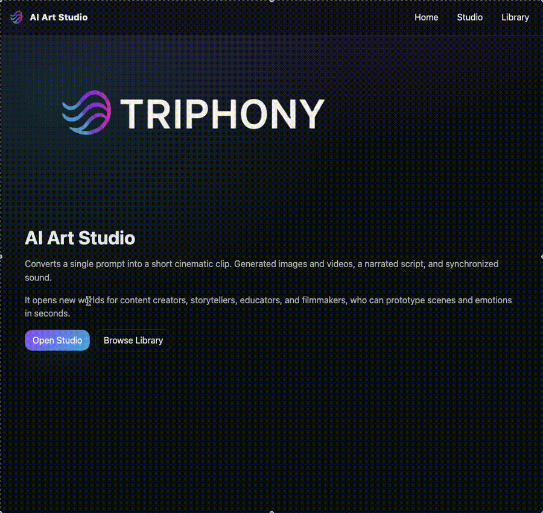
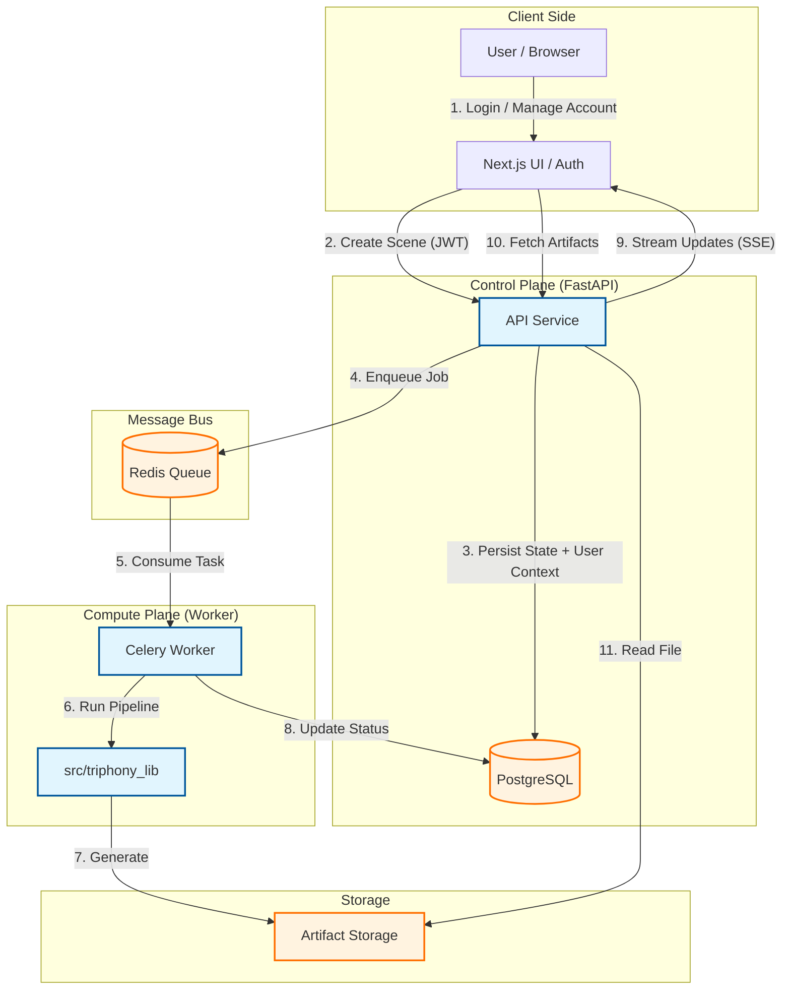

# Triphony AI Art Studio 🎬



**An Event-Driven Generative AI Platform** designed to orchestrate multi-modal asset generation (Video, Audio, Narrative) from a single conceptual prompt.

This project demonstrates a production-grade architecture for handling long-running inference tasks. It decouples the user interface from the generation pipeline using an asynchronous worker pattern, ensuring a responsive experience even when orchestrating complex generative models.

## Architectural Highlights

*   **Asynchronous Task Orchestration:** Utilizes **Celery** and **Redis** to manage heavy inference workloads off the main thread, allowing the system to scale worker nodes independently of the API layer.
*   **Real-Time State Synchronization:** Implements **Server-Sent Events (SSE)** to stream granular progress updates and state changes to the frontend immediately as workers complete tasks.
*   **Provider-Agnostic Design:** The worker layer uses a deterministic mock boundary for the Phase 1 vertical slice. Paid providers are intentionally not enabled yet.
*   **Immutable Asset Versioning:** Generative iterations are version-controlled, preserving history and preventing data loss during creative exploration.

## Architecture



## System Components

```text
apps/web/                 Next.js dashboard (React + TypeScript)
                          - Studio UI (Home / Studio / Library)
                          - SSE consumption for live progress updates
                          - Responsive playback (image/video/audio) + editor actions

services/api/             FastAPI service (Python)
                          - REST API for scenes/assets (create, fetch, regenerate)
                          - SSE event stream for pipeline status
                          - Artifact serving (returns signed/served URLs)

services/worker/          Celery worker (Python)
                          - Consumes jobs from Redis
                          - Runs generation pipeline (mock or real providers)
                          - Writes artifacts + updates DB status

src/shared/               Shared library (Python)
                          - Celery app definition + task contracts
                          - Shared types/config helpers used by API + worker


## Quick Start (fake mode)

This guide assumes a standard macOS/Linux environment with Docker installed.

### 1. Start the complete stack

Docker is the supported clean-checkout runtime. The command builds and starts web, API, worker, PostgreSQL, Redis, and the migration job:
```bash
docker compose up --build
```

The migration job runs Alembic before the API and worker become healthy. Keep this command running while using the application.

**Access points:**

*   **Dashboard:** [http://localhost:3000](http://localhost:3000)
*   **API health:** [http://localhost:8000/api/v1/health](http://localhost:8000/api/v1/health)
*   **API documentation:** [http://localhost:8000/docs](http://localhost:8000/docs)

### 2. Stop the stack
```bash
docker compose down
```

The named PostgreSQL volume is retained by `docker compose down`, so scenes persist across restarts. Use `docker compose down -v` only for an intentional local reset.

### 3. Local non-Docker checks

If running services directly, install the existing dependency sets and apply migrations first:
```bash
python3 -m venv .venv
source .venv/bin/activate
pip install -r services/api/requirements.txt -r services/worker/requirements.txt
export PYTHONPATH="$(pwd)/services/api/src:$(pwd)/services/worker/src:$(pwd)/src"
alembic -c services/api/alembic.ini upgrade head
```

Run focused backend tests:
```bash
pytest -c services/api/pytest.ini services/api/tests
```

Run frontend checks:
```bash
cd apps/web
npm ci
npm run typecheck
npm run build
```

The browser acceptance script uses the official Playwright package. After installing dependencies once, install its local Chromium binary if needed and run it while the Compose stack is up:
```bash
npx playwright install chromium
npm run test:e2e
```

### 4. Accepted local flow

Register and log in through the UI, submit a prompt in Studio, wait for authenticated SSE updates, and confirm the narrative, MP4 video, and WAV audio render. Refresh the browser, open Library, and reopen the same scene. Mock mode requires no AI-provider keys and labels its generated assets as deterministic demo output.

Authentication uses a server-issued JWT in an HttpOnly cookie. The browser never stores a token in localStorage and artifact URLs are authenticated API routes, not filesystem paths.

## Configuration & Providers

The system supports a `PROVIDER_MODE` configuration in `.env`:

*   `fake`: (Default) Generates deterministic local demo assets with FFmpeg/WAV tooling and never calls a provider. `mock` remains a compatibility alias.
*   `real`: Selects the Phase 3 provider adapters and fails closed when Vertex AI ADC/IAM or ElevenLabs configuration is incomplete. It does not silently fall back to fake output.

### Phase 3 provider boundary

The worker contains provider adapters under `services/worker/src/providers/`. The core contracts in `src/triphony_lib/` remain provider-neutral:

* Gemini Narrative Director requests structured `ScenePlan` JSON and validates timing, media specifications, scene identity, and provenance.
* Veo submits an asynchronous video operation, preserves its external operation identifier in the provider job, and exposes bounded polling that returns a `gs://` output URI without copying it into S3.
* Gemini QA accepts the approved plan and provider-neutral asset metadata and returns structured findings, score, recommendation, and retryability signals.
* ElevenLabs keeps narration, music, ambience, and sound effects as separate asset versions. The official Python SDK is created lazily and its API key is never returned or logged.

Provider configuration is backend-only. Vertex AI uses Google Application Default Credentials and IAM; it is not configured with an API key. ElevenLabs uses `ELEVENLABS_API_KEY`, which must not be placed in `NEXT_PUBLIC_*` variables or frontend code. Copy `services/api/.env.example` for the full configuration contract.

Inspect configuration without exposing secrets:

```bash
PYTHONPATH="$(pwd)/services/api/src:$(pwd)/services/worker/src:$(pwd)/src" python -m providers.readiness
```

The command reports configuration presence and capabilities, not connectivity. Live provider smoke tests are intentionally not part of automated verification; they require explicit authorization, valid ADC/IAM, paid quotas, and controlled cost limits. No live paid provider calls have been executed for this phase.

### Phase 4 durable workflow

Scene creation now enters a PostgreSQL-backed workflow:

```text
prompt -> Narrative Director -> ScenePlan -> parallel visual/audio work
       -> technical QA -> agent QA -> bounded selective regeneration
       -> FFmpeg assembly -> final QA -> persisted FinalRender
```

The worker uses Celery groups and chords for independent media branches and stores workflow state, provider jobs, asset-version lineage, QA evaluations, checksums, and final-render manifests in PostgreSQL. Candidate replacements remain draft until final QA succeeds; rejected and superseded history remains queryable. FFmpeg/FFprobe runs with artifact-root path validation, bounded timeouts, temporary output, atomic publication, and browser-compatible MP4 settings. Authenticated SSE reports the persisted workflow state, and the final render remains protected by scene ownership across refreshes and service restarts.

Fake mode remains the default and uses deterministic local media, so the Phase 4 acceptance flow requires no paid credentials. Real provider adapters are selected only when explicitly configured and fail closed when required configuration is missing; live provider calls and quality/cost verification remain intentionally deferred.

The Phase 4 workflow follows the official [Celery canvas documentation](https://docs.celeryq.dev/en/stable/userguide/canvas.html), [FFmpeg filters documentation](https://ffmpeg.org/ffmpeg-filters.html), [SQLAlchemy session transaction documentation](https://docs.sqlalchemy.org/en/20/orm/session_basics.html), and [SQLAlchemy row-locking API](https://docs.sqlalchemy.org/en/20/core/selectable.html).

Official references consulted for the adapter boundary:

* [Google Gen AI Python SDK](https://googleapis.github.io/python-genai/)
* [Vertex AI structured output](https://cloud.google.com/vertex-ai/generative-ai/docs/samples/generativeaionvertexai-gemini-controlled-generation-response-schema-2)
* [Vertex AI Veo video generation](https://cloud.google.com/vertex-ai/generative-ai/docs/video/generate-videos-from-text)
* [ElevenLabs Python SDK](https://github.com/elevenlabs/elevenlabs-python)
* [ElevenLabs text-to-speech](https://elevenlabs.io/docs/api-reference/introduction)
* [ElevenLabs music](https://elevenlabs.io/docs/api-reference/music/compose)
* [ElevenLabs sound effects](https://elevenlabs.io/docs/api-reference/text-to-sound-effects/convert)

### Phase 5 resilience and deployment boundary

Phase 5 adds offline-verified seams for policy-controlled Runway active-passive fallback, Redis-backed circuit breaking and quotas, bounded retries, transactional outbox dispatch, dead-letter inspection/replay, cancellation, audit events, safety checks, private local/S3 artifact storage, authenticated delivery, and no-op-by-default OpenTelemetry spans. The local Compose default remains `PROVIDER_MODE=fake` and `ARTIFACT_STORAGE_BACKEND=local`; S3 and Runway are configuration-selected backend capabilities and were not exercised against external services.

The deployment-readiness checklist is in [`docs/deployment-readiness.md`](docs/deployment-readiness.md). It documents secret ownership, IAM/ADC boundaries, probes, worker and migration startup, storage migration, backups, recovery, scaling, rollback, and the live smoke-test sequence without provisioning cloud resources. The operator commands are:

```bash
docker compose --project-name triphony-codex-20260927 build
docker compose --project-name triphony-codex-20260927 run --rm migrate
docker compose --project-name triphony-codex-20260927 up -d
docker compose --project-name triphony-codex-20260927 exec api alembic check
```

The Runway adapter follows the official [Runway API documentation](https://docs.dev.runwayml.com/) and its documented asynchronous task lifecycle; the S3 boundary follows the official [Boto3 upload](https://docs.aws.amazon.com/boto3/latest/guide/s3-uploading-files.html) and [S3 presigned URL](https://docs.aws.amazon.com/AmazonS3/latest/userguide/using-presigned-url.html) guidance. No paid provider call, AWS resource, deployment, commit, or push was performed.

## License
All rights reserved.
