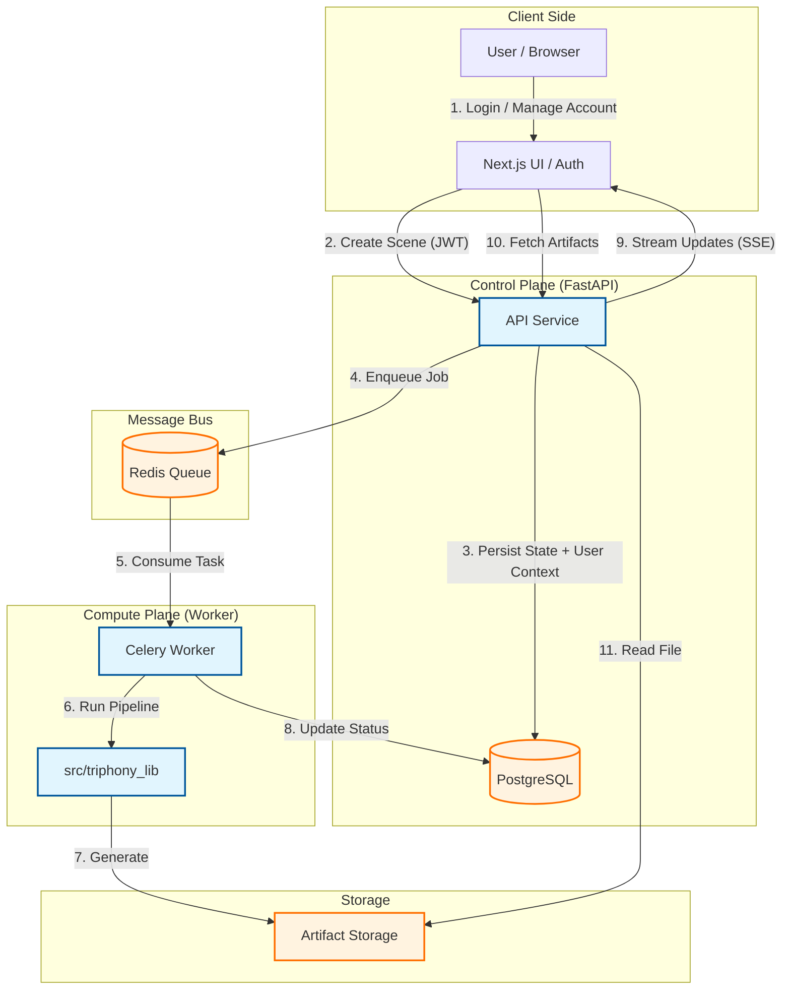
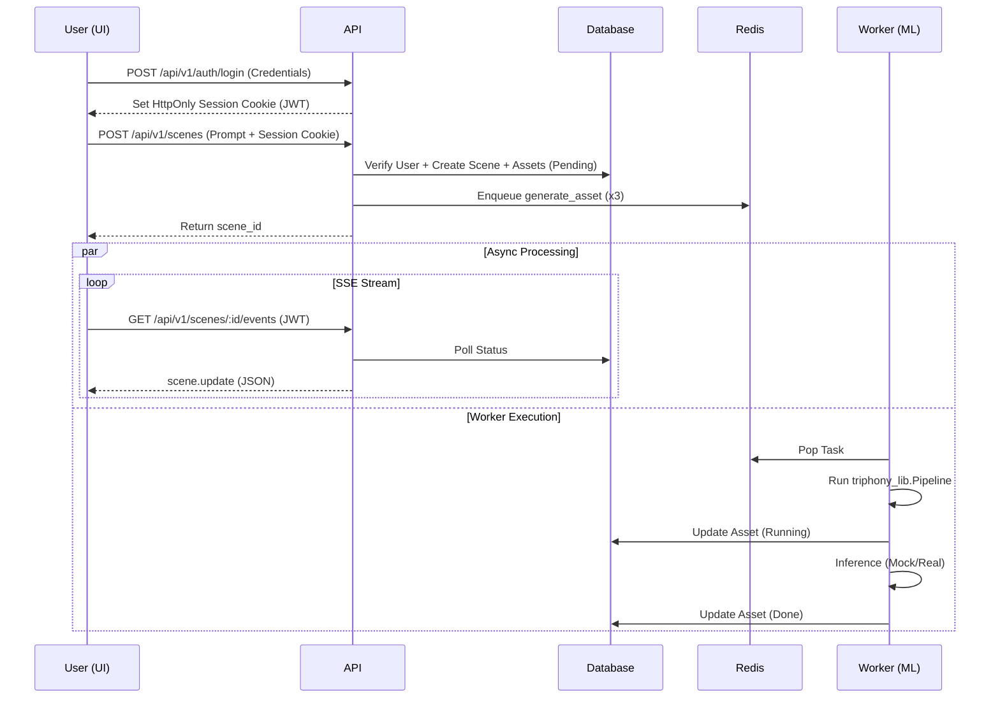
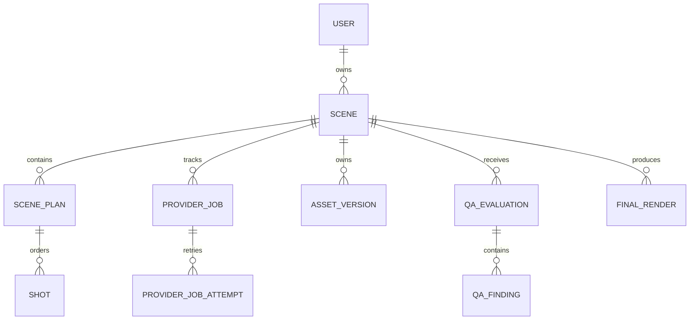
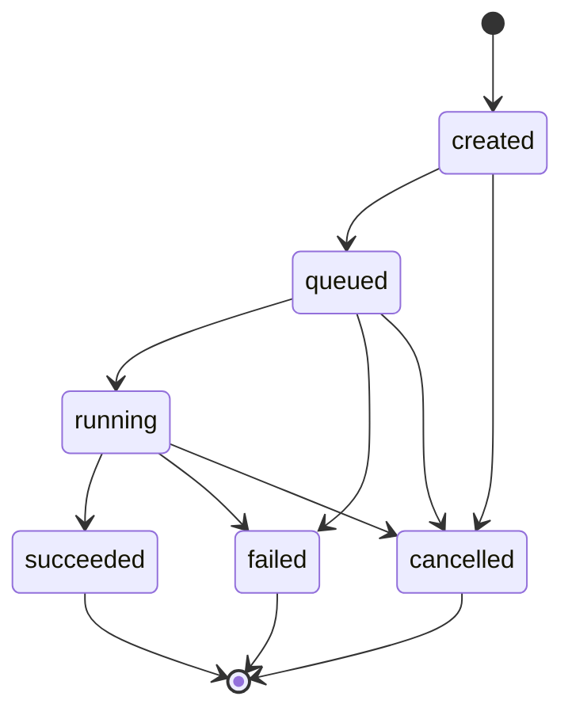

# Architecture (Portfolio Edition)

This repo is shaped like a real workflow product:

- **Next.js UI**: dashboard + editor UX (fast, responsive)
- **FastAPI API**: creates jobs, serves artifacts, streams status to the UI (SSE)
- **Celery worker**: runs long tasks (narrative/visual/soundtrack) without blocking HTTP
- **Postgres**: persistence (scenes + assets + versions)
- **Redis**: broker + results backend for Celery

## System Diagram



## Workflow Sequence



## Workflow

1) User authenticates with FastAPI and receives a JWT in an HttpOnly session cookie.
2) UI calls `POST /api/v1/scenes` with a prompt and browser credentials.
3) API verifies user, writes `Scene` + placeholder `Asset` rows.
4) API enqueues 3 worker tasks (fan-out).
5) Worker generates mock artifacts and updates DB.
6) UI subscribes to `GET /api/v1/scenes/{id}/events` (SSE polling) and refreshes cards.

Mock mode is the default so reviewers can run this with **zero keys**. Phase 1 does not call paid AI providers.

## Phase 2 provider-neutral domain foundation

Phase 2 preserves the Phase 1 mock vertical slice and adds the contracts needed before any paid provider adapter is introduced. The core domain layer is `src/triphony_lib/domain.py`; it contains no Gemini, Veo, ElevenLabs, Runway, AWS, or S3 types.

### Domain boundaries

The four logical agents are represented by typed protocols in `src/triphony_lib/agents.py`:

1. **Narrative Director** accepts a user request and production constraints and returns a validated `ScenePlan` with ordered shots, integer-millisecond timing, narration, visual, camera, and audio direction.
2. **Visual Agent** accepts an approved plan or shot and returns a provider-neutral visual `ProviderJob` and immutable `AssetVersion` metadata.
3. **Audio Agent** accepts an approved plan and returns provider-neutral narration, music, ambience, and sound-effect asset versions.
4. **QA Agent** accepts a plan and generated asset metadata and returns a structured `QAEvaluation` with a score, findings, and recommendation.

The **Media Assembler** remains a deterministic responsibility for a later phase. It will consume approved versions and produce a new `FinalRender`; it is not a fifth AI agent.

Deterministic implementations in `src/triphony_lib/fakes.py` are test-only seams. Their provenance is explicitly `deterministic-mock`, and their `mock://` artifact URIs are never presented as real AI output.

### Entity relationships



All Phase 2 records retain a `scene_id` ownership boundary. Provider-job idempotency keys are unique, asset-version identity is unique per scene/media/version, provider attempts are unique per job/attempt number, and final-render versions are unique per scene/version. Generation history is additive: a new version is inserted rather than overwriting an approved version.

### Lifecycle and timing rules



`ShotTiming` uses integer milliseconds throughout the domain. A `ScenePlan` rejects empty prompts, non-consecutive shot order, descending start times, and overlapping shots. Output specifications validate MIME types against the declared media type. Pydantic validation errors are the contract boundary; lifecycle transition errors are raised when a previously constructed job is advanced through an unsupported state.

`AssetVersion` contracts are frozen and include provenance, provider/model metadata, and a creation timestamp. `ProviderJob` carries an idempotency record and failure information. Fake agents reuse the same result for the same idempotency key and reject reuse of that key for a different request.

### Persistence and migrations

The additive migration `20260927phase2` adds `scene_plans`, `shots`, `provider_jobs`, `provider_job_attempts`, `asset_versions`, `qa_evaluations`, `qa_findings`, and `final_renders`. It preserves the Phase 1 tables and supports downgrade/upgrade of the Phase 2 revision. Runtime startup still uses Alembic as the schema authority; `Base.metadata.create_all()` remains test-only infrastructure.

The implementation follows the existing SQLAlchemy 2 declarative mapping style and Pydantic v2 validation/frozen-model configuration. Migration operations remain explicit in Alembic revision files:

- [Pydantic models and validation](https://docs.pydantic.dev/latest/concepts/models/)
- [Pydantic model configuration](https://docs.pydantic.dev/latest/api/config/)
- [SQLAlchemy declarative mapping](https://docs.sqlalchemy.org/en/20/orm/declarative_mapping.html)
- [SQLAlchemy relationships](https://docs.sqlalchemy.org/en/20/orm/relationships.html)
- [Alembic migration tutorial](https://alembic.sqlalchemy.org/en/latest/tutorial.html)
- [Python Protocols](https://docs.python.org/3/library/typing.html#typing.Protocol)

## Phase 3 provider adapters

Phase 3 connects the provider-neutral interfaces to official SDK boundaries while keeping SDK objects and exceptions out of `src/triphony_lib/`. The dependency direction is:

```text
src/triphony_lib domain + protocols
            <- services/worker/src/providers adapters
            <- google-genai / elevenlabs official Python SDKs
```

`services/worker/src/providers/` contains the configuration contract, lazy client factories, error translation, Gemini narrative and QA adapters, the Veo submit/poll adapter, the ElevenLabs audio adapter, a single provider factory, and a secret-safe readiness command. Provider jobs use the Phase 2 `ProviderJob` and `ProviderJobAttempt` contracts; the adapters return only provider-neutral job, asset, plan, and QA models.

### Configuration and credentials

`PROVIDER_MODE=fake` is the default for local development and tests. It requires no credentials and selects the deterministic Phase 2 fake agents. `mock` is accepted as a backwards-compatible alias. `PROVIDER_MODE=real` selects the production adapters and fails closed unless Vertex project/location, Vertex mode, Veo output `gs://` URI, ElevenLabs API key, and ElevenLabs voice ID are present and non-placeholder.

Vertex AI uses Google Application Default Credentials and IAM through the official Google Gen AI client. No service-account key or provider credential belongs in source control, a Docker image, a database row, frontend variables, an SSE event, or a log. ElevenLabs credentials are read only by the backend worker boundary.

Run the sanitized inspection command with the worker and shared source paths on `PYTHONPATH`:

```bash
PYTHONPATH="$(pwd)/services/api/src:$(pwd)/services/worker/src:$(pwd)/src" python -m providers.readiness
```

Its `configuration_present` and `capabilities` fields are configuration checks only; `live_verification_executed` remains false until an explicitly authorized smoke test is run.

### Adapter lifecycle

1. **Gemini Narrative Director** builds a cinematic-only prompt, requests `application/json` using the `ScenePlan` JSON schema, validates the response with Pydantic, and rejects malformed, unsafe, mistimed, or incomplete plans.
2. **Veo Visual Agent** submits a text-to-video request with a bounded duration and configured GCS output prefix. It records the returned operation ID in `ProviderJob.provider_job_id`, polls an existing operation through a finite deadline, maps pending/succeeded/failed/cancelled states, and returns a draft asset whose URI remains at the provider boundary.
3. **Gemini QA Agent** sends the approved plan and provider-neutral asset metadata for visual, narrative, audio, and cross-modal evaluation. It validates `QAEvaluation` findings, score, recommendation, scene identity, asset identity, and shot references. Regeneration is deliberately outside the adapter.
4. **ElevenLabs Audio Agent** calls the official text-to-speech, music, and sound-effects capabilities through separate logical asset paths. It rejects empty/non-audio/oversized responses, records safe byte/content metadata and request IDs, derives deterministic artifact identifiers from internal IDs, and never stores the binary in PostgreSQL.

Provider error translation normalizes configuration, authentication, authorization, quota/rate-limit, invalid request, safety, unavailable, timeout, malformed response, unsupported, terminal, and retryable failures. Only safe provider request IDs may be retained for troubleshooting; raw exception text and credentials are not copied into `FailureInfo`.

Phase 3 is adapter and contract verification only. Full narrative-first orchestration, selective regeneration, FFmpeg assembly, Runway fallback, S3 storage, and deployment remain later phases. Real provider code exists, but automated tests use deterministic injected client substitutes and no paid provider request has been executed. The application must not be marketed as live-provider verified until controlled smoke tests pass.

## Phase 4 durable orchestration

Phase 4 adds the provider-neutral workflow without moving provider SDK dependencies into the API or domain layer:

```text
POST scene
  -> queued/planning
  -> persisted ScenePlan
  -> Celery chord(group(visual shots, audio))
  -> technical_qa
  -> agent_qa
  -> draft asset versions or bounded selective regeneration
  -> assembling with FFmpeg/FFprobe
  -> final_qa
  -> approved asset versions + FinalRender + completed
```

PostgreSQL is the source of truth for `Scene.workflow_state`, `ScenePlan`, provider jobs, asset versions, QA evaluations, and final renders. Redis/Celery carries execution messages. Each worker task opens a short database transaction, persists its boundary, and never synchronously waits on another Celery task. Celery groups fan out independent shot/audio work and the chord callback waits for every required branch before technical QA; the workflow uses the official [Celery canvas primitives](https://docs.celeryq.dev/en/stable/userguide/canvas.html).

Generated asset versions begin as `draft`. Technical and agent QA evaluate the latest candidate set. Only after final QA succeeds are candidates promoted to `approved`; prior approved versions become `superseded` and remain queryable through `parent_id`, checksum, provenance, and metadata. A rejected candidate therefore cannot replace the last accepted render. QA findings target a shot or logical audio asset; the orchestrator regenerates only those targets, increments a bounded attempt counter, and re-enters the same persisted plan.

`services/worker/src/workflow/media.py` is the deterministic media boundary. It accepts artifact-root-relative paths only, invokes FFmpeg/FFprobe with argument arrays and bounded timeouts, validates streams, concatenates ordered visual inputs, mixes narration/music/ambience/effects with a documented gain, writes a temporary render, atomically publishes the MP4, and returns a manifest containing checksums, measured duration, stream metadata, FFmpeg version, and configuration version. The implementation follows the official [FFmpeg filters documentation](https://ffmpeg.org/ffmpeg-filters.html) for `amix` and the official [FFmpeg concatenation guidance](https://www.ffmpeg.org/faq.html).

The API exposes the accepted final render in the existing scene/library representation and protects `/api/v1/final-renders/{id}` with the scene ownership query. Authenticated SSE snapshots are generated from PostgreSQL and complete only for terminal workflow states. The browser continues to use the existing narrative/video/audio panels; the visual panel receives the assembled MP4 through the existing authenticated artifact route.

The workflow uses SQLAlchemy transaction/rollback boundaries and PostgreSQL row-locking support while keeping model/provider/FFmpeg work outside database locks. See the official [SQLAlchemy session transaction documentation](https://docs.sqlalchemy.org/en/20/orm/session_basics.html) and [SQLAlchemy `with_for_update` documentation](https://docs.sqlalchemy.org/en/20/core/selectable.html).

Phase 4 fake mode is deterministic and local. Real provider adapters remain available behind the Phase 3 factory, but this orchestration does not materialize remote provider URIs as local fake results in real mode; live provider connectivity, media quality, cost, and fallback behavior remain unverified and are deferred to Phase 5.

## Phase 5 controls and deployment boundary

Phase 5 preserves the Phase 4 workflow and adds the following provider-neutral boundaries:

- `RunwayVisualAgent` is a lazy official-SDK adapter. `ActivePassiveVisualAgent` invokes it only for policy-approved transient primary failures, records fallback provenance, and uses the Redis circuit breaker to stop repeated primary attempts. Polling uses the provider's asynchronous task states and a configured deadline; the local/test path never imports the SDK or calls the network.
- `ArtifactStore` has local and S3 implementations. Local writes are path-safe, temporary, checksum-verified, and atomic. S3 uses private objects, checksum metadata, server-side encryption configuration, verified upload metadata, and short-lived presigned delivery. Database ownership checks happen before either delivery path.
- Redis-backed circuit state, bounded exponential retry with jitter, an outbox event key, dead-letter records, replay CLI, and cancellation are explicit operational controls. The API publishes the outbox event after the scene transaction commits; recovery operators can dispatch pending events and replay dead letters without an HTTP replay endpoint.
- Submission safety checks, prompt/scene/duration/concurrency quotas, CSRF/origin checks, trusted-host/CORS restrictions, request-size limits, security headers, audit rows, correlation IDs, and redacted structured logs are enforced at the API boundary. Fake mode tolerates a missing local Redis only for developer ergonomics; deployed Compose and real mode fail closed when the governance store is unavailable.
- OpenTelemetry is an optional no-op-by-default boundary. HTTP, orchestration, provider, storage, and assembly operations must add spans only through the shared helper, with secrets, credentials, cookies, and signed URLs redacted.

`docs/deployment-readiness.md` is the operational handoff for a future deployment. It does not provision AWS, configure a live provider, or claim production readiness. The current verified runtime remains the deterministic fake-mode Compose stack.
